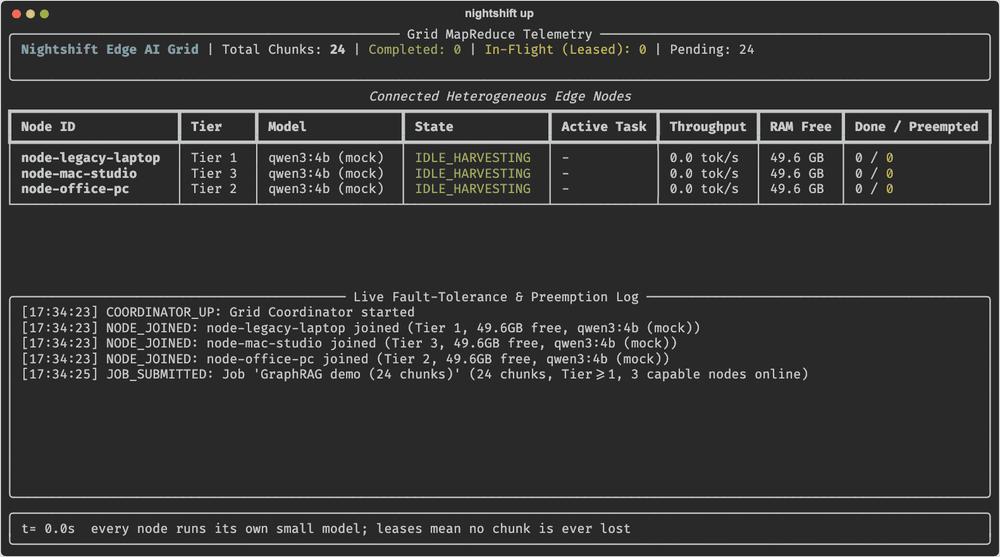

# Nightshift Grid ⚡️

[](https://github.com/redd34/nightshift-grid/actions/workflows/ci.yml)
[](https://github.com/redd34/nightshift-grid/blob/main/LICENSE)
[](https://pypi.org/project/nightshift-grid/)


**Turn idle laptops, office PCs and legacy mini-PCs into a zero-CapEx, fault-tolerant local AI batch and GraphRAG cluster.**

```bash
pipx install nightshift-grid     # or: uv tool install nightshift-grid
nightshift up --mock --workers 3 # coordinator + 3 workers + live dashboard
```



<sub>A real (mock-inference) run recorded with `scripts/record_demo.py`. Benchmarks so far are from a single Mac; see [Known limitations](#known-limitations-and-roadmap).</sub>

Nightshift Grid is a lightweight distributed compute engine ("SETI@home meets local enterprise
MapReduce"). It harvests idle cycles across mixed local machines without slowing down the
people using them.

It doesn't slice one giant model across slow LAN links, where Wi-Fi jitter destroys token
throughput and one closed laptop lid kills the forward pass. Instead, every machine is a
**preemptible, fenced micro-worker** running its own quantized small model (`qwen3:4b`,
`qwen2.5:3b`, `phi4-mini`) via Ollama. A central coordinator hands out **leased** chunks.
When a human touches the machine, the node yields immediately and its chunk moves to another node.

```
           submit 24 chunks                      output_graph.jsonl
 client ──────────────────────▶ Coordinator ───────────────────────▶ (1 record / chunk)
                                 │  ▲  lease(task_id, lease_id) / heartbeat 3s / complete / preempt
                 ┌───────────────┼──┼────────────────┐
                 ▼               ▼  │                ▼
          node-office-pc   node-legacy-laptop   node-mac-studio     each: worker_daemon.py
            (Tier 2)          (Tier 1)             (Tier 3)              + local Ollama
```

---

## Why this exists

Most teams have gigabytes to terabytes of unstructured PDFs, logs and tickets that can't go to
cloud APIs for cost or privacy reasons. Meanwhile the office PCs, laptops and mini-PCs that could
process them sit mostly idle all day and fully idle overnight.

The common ways to pool local machines leave a gap for batch pipelines:

| Approach | Typical failure mode for batch work | Nightshift Grid |
|---|---|---|
| **Tensor/layer splitting** (one big model sharded across machines) | Bound by LAN serialization. One node dropping mid-pass stalls the whole request. | Each node runs a whole small model on independent chunks. A dropped node costs one chunk retry. |
| **Stateless request routing** (load-balance chat requests across nodes) | No durable job state, so a node dying mid-request fails that request. | Stateful MapReduce queue with fenced leases. Every chunk completes or is explicitly dead-lettered. |
| **Dedicated inference pools** | Machines must be handed over to the cluster. | Good-citizen harvesting: the human always wins and the grid backs off in milliseconds. |

Capability tiers decide what each node gets: Tier 1 (<8GB free) does embeddings and chunking,
Tier 2 (8–24GB) does 3B–8B INT4 entity/relationship extraction, and Tier 3 (>24GB, or Apple
Silicon with ≥16GB free) does heavy verification and synthesis.

---

## Key highlights and live benchmarks

### 1. Sub-250ms GPU yield, including during model load and prompt eval

A common trap when wrapping Ollama or `llama.cpp` in Python is breaking out of the token loop
without closing the underlying socket. The server keeps generating, and the GPU stays pegged
until the response finishes. A second trap is checking for user activity only when a token
arrives. That leaves a blind spot while the model is loading weights or evaluating a long prompt.

Nightshift runs inference in its own asyncio task. An out-of-band activity watcher polls the
chaos trigger file every 100ms and OS HID idle time every 500ms: `ioreg -c IOHIDSystem` on macOS,
`GetLastInputInfo` on Windows, `xprintidle` on Linux. On activity it calls `task.cancel()`,
which unwinds `async with client.stream(...)` and closes the connection, so Ollama stops
generating.

Measured with `qwen3:4b` on Apple Silicon (GPU utilisation from IOKit, 250ms samples):

| Worker cancellation method | GPU utilisation afterwards |
|---|---|
| Stop the read loop, leave the response open | **84–94% until the model finishes** |
| Error raised inside `async with client.stream` | **0% by the first sample**; next request ready in 0.04s |
| Out-of-band `task.cancel()` (also covers model load and prompt eval) | **0% by the first sample** |

### 2. End-to-end chaos benchmarks

Three workers (`qwen3:4b`, about 130 tok/s decode) processed a 24-chunk industrial-maintenance
GraphRAG extraction job per phase, with auth enabled (`python nightshift.py chaos-test --model qwen3:4b`). All three workers ran on one Mac sharing one Ollama
instance. Multi-machine runs are still to do.

| Chaos scenario / metric | Measured result |
|---|---|
| **Live human preemption** (user returns mid-job on `node-legacy-laptop`) | **24/24 chunks** in 47.3s, 0 failures |
| Activity → coordinator reclaims the lease (trigger file, 100ms poll) | **0.01–0.10s** across runs (0.011s in the final run) |
| Lease reclaimed → re-assigned to another node | **0.8s** |
| Activity → preempted chunk finished on the backup node | **5.2s** |
| Work sent to the paused node while the human is active | **0 chunks** |
| **Worker crash** (`SIGKILL node-office-pc` mid-chunk) | **24/24 chunks** in 45.8s |
| `SIGKILL` → lease expiry (12s TTL) → re-assigned → done | **11.9s → +1.1s → 16.8s total** |
| **Coordinator crash** (`SIGKILL` coordinator mid-job, 3s outage, restart on same SQLite file) | **24/24 chunks** in 46.4s, **24 attempts for 24 chunks (0 wasted)** |
| Restart → ready; in-flight leases finished by their original holders | **0.23s; 2/2** |
| **Host CPU spike** (busy-loop on all 16 cores mid-job, `--max-host-cpu-pct 65`) | **24/24 chunks** in 54.4s; all 3 workers yielded (`cpu_busy`) in **1.9–2.7s**, 0 leases while loaded, all resumed **2.1s** after the load stopped |
| Unintended preemptions from the grid's own Ollama load (phases 1–3) | **0** |
| **Auth** (anonymous submit / worker token on client API / forged completion) | **401 / 401 / 401** |
| **Output integrity** (4 jobs) | **96/96 records, 0 missing, 0 duplicates, 434 triples** |

With `--native-idle-seconds`, detection latency is bounded by the 500ms HID poll rather than the
100ms file poll. The HID path is covered by unit tests and a live `ioreg` read. An end-to-end
benchmark with real keyboard input is still to do, because synthesising HID events needs macOS
Accessibility permission.

---

## Core guarantees

| Guarantee | Mechanism |
|---|---|
| **No chunk lost** | Every lease has a 12s TTL, extended by 3s heartbeats, and a reaper re-queues expired leases. Preemption and graceful `SIGTERM` hand leases back immediately. A worker can hold only one lease at a time. |
| **Fenced leases (no split-brain)** | Each assignment carries a unique `lease_id`. A partitioned or stalled worker can't heartbeat or complete a lease that was re-issued. The heartbeat reply (`lease_valid: false`) tells it to abort the zombie compute. |
| **Race-free pull and pause** | If a human returns while a pull is in flight, the new lease goes straight back. Preempt messages name their lease, so a late one can't revoke a newer lease. A paused node gets no work until it reports idle. |
| **Dead-letter protection** | Errors and lease expiries count toward `MAX_FAILURES=3`, after which the chunk is parked as `FAILED`. Human preemptions don't count as failures. |
| **Clean graph output** | Ollama structured outputs (a JSON schema) constrain decoding. `normalize_extraction()` coerces the output to `[subject, RELATION, object]` and canonicalises relation names (`exceeded during` → `EXCEEDED_DURING`) so edges merge across chunks. Reasoning tokens are disabled on thinking models (`qwen3`). Invalid output is a retryable failure. |
| **Idempotent sink** | `output_graph.jsonl` is fsynced per record and deduplicated by `task_id`, including across a coordinator restart or a failed fsync. Retried completions are no-ops. |
| **Capability-aware scheduling** | A worker serves the highest tier it's capable of first, so Tier 3 nodes aren't spent on Tier 1 work while Tier 3 work waits. Recovered chunks go to the front of the queue. |
| **Survives coordinator crashes** | Every state transition is journaled to SQLite (WAL) in one transaction. On restart, queue order, results and dead letters are recovered, and in-flight leases get a fresh TTL so workers that kept computing can still complete them. Workers retry completions for 30s to ride out the restart. About 11k durable transitions/s; a 50k-task job recovers in 0.3s. |
| **Least-privilege auth** | Separate bearer tokens for workers (`/worker/*`) and clients (`/v1/*`), so a compromised laptop can lease work but can't submit jobs or read results. Each worker registration gets a session secret (`X-Nightshift-Session`), so a live worker's id can't be hijacked. Constant-time comparison. Tokens come from files or env, never argv. Reused token files must be regular, owned by you and 0600 (no symlinks). The coordinator binds loopback by default and refuses a LAN bind without tokens. Browser `Origin` requests are refused, and in no-auth loopback mode untrusted `Host` headers are refused too (DNS-rebinding protection). |
| **Good citizen beyond the keyboard** | Workers also pause on battery power (`--allow-battery` to opt out) and under thermal throttling (macOS `pmset`, Linux sensors). They pause when *other* processes push host CPU over `--max-host-cpu-pct` (default 65; Ollama and co-located workers are excluded; sustain and hysteresis prevent flapping). They pause when free RAM drops under `--min-free-ram-gb` (default 2.0), evicting the model with `keep_alive: 0`; the resume threshold includes the model's size, so unloading can't cause a pause/reload loop. |
| **Fail-closed idle sensing** | With `--native-idle-seconds`, a worker that can't read HID idle time refuses to start (`--allow-no-idle-sensor` overrides). Sensors: macOS `ioreg`, Windows `GetLastInputInfo`, GNOME/Wayland Mutter and freedesktop ScreenSaver over D-Bus, X11 `xprintidle`. If a sensor dies at runtime, the worker pauses (`idle_sensor_lost`) rather than guessing. |
| **Zero-config LAN discovery** | `worker_daemon.py --discover` finds the coordinator over UDP broadcast. The reply carries an HMAC proof keyed by the worker token, so a rogue host can't impersonate the coordinator and harvest tokens. Replays fail (fresh nonce), two valid coordinators are an error, and responses are size-capped and rate-limited (not an amplifier). |
| **Live vector index (optional)** | `--qdrant-url` adds a Qdrant sink alongside the always-on JSONL. Writes are queued off the event loop, batched, embedded (nomic-embed-text, or a deterministic hash embedder) and upserted idempotently into `nightshift_graph`. Failures spool to disk and replay, and never fail a completion. One embedder per collection is enforced. |
| **Preemption without lost work (Baton relay, opt-in)** | With `coordinator.py --relay`, a worker streams its partial output to the coordinator as small deltas on the heartbeat it already sends, plus the exact text at the moment it yields. When a lease ends early (human returns, Wi-Fi drops, SIGKILL), the next worker on the **same model** continues the generation from that text instead of from token zero. Checkpoints are fenced by `lease_id`, only grow, and are journaled with the task, so they survive a coordinator crash too. A resumed attempt that fails validation drops the checkpoint, so a bad prefix can't loop. Live resume uses a raw prompt that's verified per model at worker startup (ChatML/Qwen today); other models restart as before. Decode accounting is always on: tokens generated, tokens in results, tokens wasted per node and goodput appear in `/v1/grid/status` → `relay`.

**Live fidelity (qwen3:4b, 3 chunks × 25/50/75% cuts, 2 runs):**
- 18/18 resumed outputs are valid; 6/18 are identical to a fresh run.
- Mean triple overlap with the fresh run is 0.70, against 0.89 between two fresh runs.
- So resumed extractions drift more than run-to-run noise, mainly because an ungrammared continuation sometimes closes the object early.
- **Relay therefore stays opt-in.** It suits slow nodes and long outputs, where restarting costs most. |
| **Resilient workers** | Non-JSON or 5xx responses are retried, not fatal. If the activity watcher or heartbeat task dies, the worker exits loudly instead of running unprotected. |

---

## Quickstart

### 1. Install

As a tool (isolated environment; puts `nightshift`, `nightshift-coordinator`, `nightshift-worker`, `nightshift-mcp`,
`nightshift-dashboard` and `nightshift-credential` on your PATH):

```bash
pipx install nightshift-grid      # or: uv tool install nightshift-grid; latest main: uv tool install git+https://github.com/redd34/nightshift-grid
ollama pull qwen3:4b                                              # any small chat model works; pass it with --model
```

From a checkout (for development; every command below also works as `python <script>.py`):

```bash
git clone https://github.com/redd34/nightshift-grid && cd nightshift-grid
python3 -m venv .venv && source .venv/bin/activate               # or: uv venv .venv
pip install -e ".[dev]"
```

### 2. Try it in 30 seconds

```bash
nightshift up --mock --workers 3          # coordinator + 3 workers + live dashboard, one terminal
nightshift submit --wait                  # (second terminal) 24-chunk demo job, zero config
nightshift status                         # one-shot table; `down` stops the grid and cleans up a crashed session
nightshift up --model qwen3:4b            # same, with real inference
```

`up` keeps tokens (0600), per-worker credentials, the state DB, output and logs in a state directory (`.nightshift/`
in a checkout, `~/.nightshift` for an installed tool, or `$NIGHTSHIFT_STATE_DIR`), so `submit`/`status` need no flags.

### 3. Verify

```bash
python -m pytest -q tests                           # 379 tests: state machine, durability fuzz, guards, auth, TLS, relay, MCP...
python nightshift.py chaos-test --mock              # 4-phase chaos benchmark, Markdown table to stdout (~2.5 min)
python nightshift.py chaos-test --model qwen3:4b    # same, against live Ollama
```

### 4. Run a grid by hand

```bash
python coordinator.py --output output_graph.jsonl --db grid_state.db   # loopback, no auth: local dev
python worker_daemon.py --id node-office-pc     --tier 2 --model qwen3:4b
python worker_daemon.py --id node-legacy-laptop --tier 1 --model qwen3:4b --native-idle-seconds 60
python worker_daemon.py --id node-mac-studio    --tier 3 --model qwen3:4b
python dashboard.py                        # live rich TUI
python demo_submit.py --wait               # submit 24 chunks and wait for the summary
touch /tmp/preempt_node-legacy-laptop      # simulate a human; rm the file to release
```

### 5. From documents to an answerable graph (map → reduce → query)

```bash
python ingest.py docs/ --tier 2 --wait                 # chunk .txt/.md/.log/.csv/.jsonl/.pdf → grid job(s) + manifest
python reduce_graph.py output_graph.jsonl --out graph.json --graphml graph.graphml \
    --qdrant http://localhost:6333 --embed-model nomic-embed-text   # entity resolution + nightshift_* collections
python reduce_graph.py query graph.json "which bearing assemblies were replaced?" --qdrant http://localhost:6333
```

`ingest.py` keeps provenance in a sidecar `<job>.manifest.jsonl`, not in the prompt, so workers never see file paths.
`reduce_graph.py` merges surface variants such as `Compressor turbine`/`Compressor: turbine`, but **never** merges names
whose numbers differ (`B-101` ≠ `B-102`, `4.2` ≠ `4.5 mm/s`). It only ever writes Qdrant collections prefixed `nightshift_`,
and it never deletes or recreates a collection.

### 6. Drive it from an AI IDE (MCP)

**Claude Code plugin** (MCP server + a skill that teaches Claude when and how to use it):

```
/plugin install nightshift-grid --marketplace redd34/nightshift-grid
```

Needs `nightshift-mcp` on your PATH (`pipx install nightshift-grid`). With no settings, the server finds the grid that
`nightshift up` started (URL and client token from its state dir) and lets Claude read files under the project directory.

**Any MCP client, by hand:**

```bash
claude mcp add nightshift -- nightshift-mcp          # optional: -e NIGHTSHIFT_MCP_ROOTS=/abs/docs:/abs/project
```

The skill on its own lives in [`skills/nightshift-grid/SKILL.md`](skills/nightshift-grid/SKILL.md); copy it to
`~/.claude/skills/` if you register the server yourself.

The server exposes 4 tools: `grid_status`, `dispatch_mapreduce_text`, `ingest_directory_to_graph` and `query_local_graph`.
File access is limited to `NIGHTSHIFT_MCP_ROOTS` (symlinks resolved, secret files refused), and tools warn when data
would leave the machine. See `docs/MCP.md` for Claude Desktop config and the security model.

### 7. Deploy as services

```bash
deploy/gen_token.sh --env > coordinator.env          # GRID_WORKER_TOKEN / GRID_CLIENT_TOKEN
# Coordinator (Linux): hardened systemd unit, steps in deploy/README.md §2
# Worker on macOS (LaunchAgent) / Linux (systemd --user); preview first with --dry-run:
printf '%s\n' "$GRID_WORKER_TOKEN" | deploy/install_worker.sh \
    --coordinator http://10.0.0.5:8000 --model qwen3:4b --tier 2 --token-stdin
# Windows (at-logon task; add -WhatIf to preview):
#   deploy\windows\install_worker.ps1 -Coordinator http://10.0.0.5:8000 -TokenFile worker.token
# Remove: deploy/install_worker.sh --uninstall [--purge]   ·   Ops guide: deploy/README.md
```

Workers run as **per-user** services (a LaunchAgent, systemd `--user`, or an at-logon task), never as system daemons.
Only a per-user service can see the logged-in user's keyboard and mouse, which preemption depends on.

Useful worker flags:
- `--mock` simulates the token stream.
- `--tier N` overrides hardware fingerprinting.
- `--native-idle-seconds N` pauses the worker while HID idle time is under N seconds.
- `--unload-on-preempt auto|always|never` sends `keep_alive: 0` to free the model's RAM. `auto` only does this under memory pressure.
- `--allow-battery`, `--min-battery-percent P`, `--ignore-thermal` and `--max-temp-c C` control the power and thermal guards.
- `--num-ctx N` (default 4096, env `NIGHTSHIFT_NUM_CTX`) is sent with every Ollama request. It is never left unset: Ollama would otherwise load the model at its own default context, which for qwen3 is 262k tokens (~40 GB).
- `--max-host-cpu-pct P` (default 65, 0 = off) and `--cpu-busy-samples N` control the CPU guard. `--min-free-ram-gb G` (default 2.0) controls the RAM guard.
- `--allow-no-idle-sensor` keeps the worker running when no HID idle sensor is available.
- `--discover` (with `--discovery-port`) finds the coordinator on the LAN, and learns its TLS fingerprint through the authenticated reply.
- `--token-file PATH` sets the worker credential. Otherwise it comes from `$GRID_WORKER_TOKEN`, `$GRID_TOKEN`, `$NIGHTSHIFT_TOKEN_FILE` or `$NIGHTSHIFT_TOKEN`. With a per-worker credential, `--id` is optional, because the credential names its id.
- `--tls-fingerprint sha256:…` pins the coordinator's certificate. `--ca-file PEM` verifies it against a CA instead. The env equivalents are `$NIGHTSHIFT_TLS_FINGERPRINT` and `$NIGHTSHIFT_CA_FILE`, which the dashboard, `demo_submit.py`, the CLI and the MCP server also read.

Coordinator flags:
- `--host` defaults to `127.0.0.1`.
- `--db grid_state.db` sets the state file (`none` = in-memory).
- `--output` sets the JSONL sink.
- `--worker-token-file` and `--client-token-file` set the tokens. Otherwise they come from `$GRID_WORKER_TOKEN`/`$GRID_CLIENT_TOKEN`, or `$GRID_TOKEN` for both.
- `--auto-tls` serves HTTPS with a self-signed certificate. It's minted on the first run next to the db and reused afterwards, and its fingerprint is printed at startup. Alternatively, use `--tls-cert` / `--tls-key`. A non-loopback bind refuses plain HTTP unless you pass `--allow-plaintext`, which is for networks that are already encrypted, such as Tailscale/WireGuard.
- `--worker-auth auto|per-worker|shared` sets how workers authenticate. The default, `auto`, means `per-worker` on a LAN bind: each worker presents a credential bound to its own id, minted with `python grid_auth.py issue --id node-x --worker-token-file worker.token --out node-x.credential`. The master worker token then never leaves the coordinator host.
- `--allow-insecure` permits a LAN bind without tokens or TLS.
- `--auto-token` generates and persists 0600 tokens on the first run.
- `--advertise` / `--no-advertise` and `--discovery-port` control LAN discovery. It's on by default for non-loopback binds.
- `--qdrant-url URL` or `--qdrant-memory`, plus `--qdrant-collection nightshift_graph` and `--qdrant-embedder auto|ollama|hash`, enable the live vector sink. `python qdrant_sink.py backfill` re-indexes from the JSONL.

---

## API

With tokens configured, `/worker/*` requires `Authorization: Bearer <worker credential>` and `/v1/*` requires the client token. A per-worker credential is `nsw1.<id>.<HMAC(master, id)>`. It only works for its own `worker_id`: using it for any other id gets a 403, and it can't mint new ids.

| Endpoint | Purpose |
|---|---|
| `GET /healthz` | Liveness probe (unauthenticated, reveals nothing). |
| `POST /worker/register` | Join, or re-join. A re-join re-queues the node's old leases. |
| `POST /worker/pull-task?worker_id=` | Lease the next chunk → `{task_id, lease_id, prompt}`. |
| `POST /worker/heartbeat` | Extend the lease and report telemetry plus progress (`gen_tokens`, and with relay a checkpoint delta `ckpt_from`/`ckpt_delta`) → `{lease_valid, ckpt_len}`. |
| `POST /worker/preempt` | `{worker_id, reason, detected_at, lease_id?, gen_tokens?, ckpt_from?, ckpt_delta?}`: hand back the lease now, with the final checkpoint. With relay, the next pull of that chunk carries `resume: {text, tokens}`. |
| `POST /worker/complete` / `/worker/fail` | Fenced by `lease_id`. |
| `POST /v1/grid/mapreduce` | Submit `{job_name, chunks[], required_tier}`. |
| `GET /v1/grid/jobs/{id}?results=true` | Progress, attempts, preemptions, dead letters and results. |
| `GET /v1/grid/status`, `/v1/grid/events?since_seq=` | Dashboard snapshot and structured event log. Sequence numbers keep increasing across restarts. |

## Project layout

| File | Role |
|---|---|
| `coordinator.py` | FastAPI control plane. `GridState` holds the whole lease state machine and takes an injectable clock, with index-backed O(leases) hot paths. |
| `grid_store.py` | SQLite (WAL) journal: one transaction per state transition, plus recovery. |
| `grid_auth.py` | Token resolution (file or env), bearer headers, and fail-fast 401 handling. |
| `worker_daemon.py` | Preemptible async worker: hardware fingerprinting, cancellable Ollama streaming, heartbeats. |
| `idle_detection.py` | `ActivityMonitor` with pluggable sources: trigger file, HID idle (macOS/Windows/Linux), battery, thermal, foreign CPU load. |
| `ingest.py` | Map-side input: walks files, chunks on paragraph/sentence boundaries with overlap, dedupes, submits jobs, writes a provenance manifest. |
| `reduce_graph.py` | Reduce side: entity resolution (key normalization, guarded embedding merge, union-find), graph.json/GraphML, Qdrant sink, and `query`. |
| `nightshift.py` | One-command CLI: `up` / `down` / `submit` / `status` / `chaos-test` / `token`. |
| `mcp_server.py` | MCP server (stdio) exposing the grid to Claude Code, Claude Desktop, Cursor and Kiro. See `docs/MCP.md`. |
| `discovery.py` | UDP LAN discovery with an HMAC proof of token possession. |
| `qdrant_sink.py` | Live Qdrant sink: background batching, disk spool, embedder consistency, and `backfill`. |
| `deploy/` | Service installers and templates: macOS LaunchAgent, systemd, Windows Task Scheduler, plus a token generator. See `deploy/README.md`. |
| `graphrag.py` | Extraction prompt, JSON schema, normalizer and idempotent JSONL sink. |
| `relay.py` | Baton token relay helpers: JSON progress scanner and online validator, verified ChatML raw-prompt renderer, grammar-per-item structured resume. |
| `chaos_test.py` | E2E harness with auth on: human-preemption, worker-SIGKILL and coordinator-SIGKILL phases, with zero-loss and zero-duplicate checks. |
| `dashboard.py`, `demo_submit.py` | TUI and batch submitter. |

## Known limitations and roadmap

- **Single-host benchmarks so far.** All three workers shared one Mac and one Ollama. The next milestone is a multi-machine pilot. Latency metrics compare worker and coordinator wall clocks, which is exact on one host but subject to NTP skew across hosts.
- **Transport and identity.** A LAN coordinator serves TLS (`--auto-tls` or your own certificate), and workers pin its fingerprint. Each worker holds a credential that's valid only for its own id, and every call is also bound to the current registration's session. What remains: a compromised worker can still submit bad results *for chunks it leases* (results aren't cross-checked yet), credentials are revoked only by rotating the master worker token, and the self-signed certificate's private key is only as safe as the coordinator host.
- **Single coordinator.** It's durable, but not highly available. Finished jobs are never pruned, so the state DB grows with history.
- **Mixed failure policy.** HID idle sensing fails closed. Battery, thermal, CPU and RAM sensors fail open with one warning each.
- **Qdrant sink and SIGKILL.** Records still in the sink's in-memory queue when the coordinator is SIGKILLed (under a second's worth) are in the JSONL but not in Qdrant until `python qdrant_sink.py backfill` runs.
- **Noisy hosts.** The default 65% CPU guard pauses workers on a busy developer machine. That's intended, but tune `--max-host-cpu-pct` for build servers.
- **Not validated on real hardware:** thermal throttling and battery unplugging (unit-tested with fakes only), the Linux and Windows installers (rendered and inspected, but never run on those OSes), and `systemd-analyze`, `shellcheck` and `pwsh` linting.
- **Extraction quality** from 3–4B models is unmeasured. Next: a small labelled set, plus Tier 3 verification/consensus on a sample.
